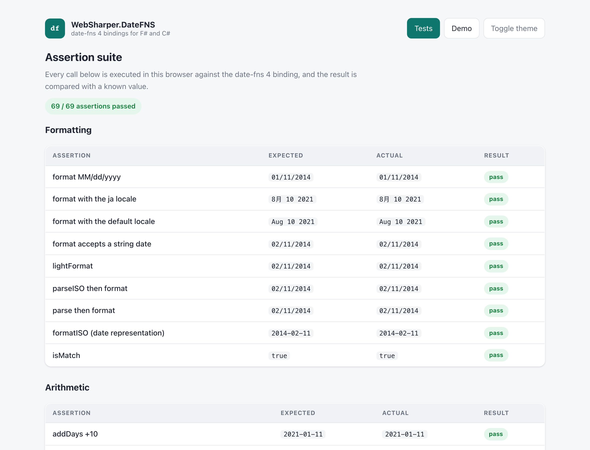

# WebSharper.DateFNS

[](https://www.nuget.org/packages/WebSharper.DateFNS)

WebSharper bindings for [date-fns](https://date-fns.org/) 4 — formatting, parsing,
arithmetic, intervals, durations and locales for F# and C# web apps.

The binding targets **date-fns 4.4.0** (`>= 4.0.0 < 5.0.0`) and is built for
WebSharper 10 on .NET 10.

This repository contains:

| Project | Purpose |
| --- | --- |
| `WebSharper.DateFNS` | The binding: WIG definitions for the `DateFNS` API, the option dictionaries, the `Locale` model and every bundled locale. |
| `WebSharper.DateFNS.Sample` | A static SPA that runs an in-browser assertion suite and an interactive demo. |

## Live demos

**Try it live:** [Open the sample in your browser](https://dotnet-websharper.github.io/datefns/)



The sample doubles as the binding's [test case](#running-the-test-case): it runs
69 assertions across the whole surface in the browser and reports pass/fail, and
it has an interactive demo for formatting, relative time, intervals and rounding.

- **Sample (this repository):** <https://dotnet-websharper.github.io/datefns/>
- **Source repository:** <https://github.com/dotnet-websharper/datefns>
- **WebSharper bindings:** <https://websharper.com/bindings>

## Features

- **Formatting and parsing:** `format`, `lightFormat`, `formatISO`, `formatISO9075`,
  `formatRFC3339`, `formatRFC7231`, `formatRelative`, `formatDuration`,
  `formatDistance`, `formatDistanceStrict`, `formatDistanceToNow`,
  `formatDistanceToNowStrict`, `intlFormat`, `intlFormatDistance`, `parse`,
  `parseISO`, `parseJSON`, `isMatch`.
- **Arithmetic:** `add*` / `sub*` for every unit, `set`, `clamp`, `min`, `max`,
  `compareAsc`, `compareDesc`, `closestTo`, `closestIndexTo`.
- **Predicates and getters:** `is*` and `get*` helpers, including the ISO week,
  week-numbering year and quarter helpers.
- **Intervals:** `interval`, `intervalToDuration`, `areIntervalsOverlapping`,
  `isWithinInterval`, `getOverlappingDaysInIntervals`, and the `each*OfInterval`
  family (with `step`).
- **Durations and conversions:** `Duration`, `formatDuration`, `milliseconds`,
  and the `*To*` conversion helpers.
- **Rounding:** `roundToNearestMinutes`, `roundToNearestHours`.
- **Generic helpers:** `constructFrom`, `constructNow`, `transpose`.
- **Locales:** every locale shipped with date-fns 4, exposed as `Locales.<ID>`
  (for example `Locales.ENUS`, `Locales.JA`, `Locales.BETARASK`, `Locales.CKB`).

Date arguments accept a `Date`, a millisecond timestamp (`int`) or an ISO string,
matching date-fns 4's `DateArg` type.

## Installation

```bash
dotnet add package WebSharper.DateFNS
```

or, from Paket:

```
nuget WebSharper.DateFNS
```

## Usage

```fsharp
open WebSharper
open WebSharper.JavaScript
open WebSharper.DateFNS

[<JavaScript>]
module Demo =
    let run () =
        // Formatting
        let date = Date(2014, 0, 11)
        DateFNS.Format(date, "MM/dd/yyyy")            // "01/11/2014"

        // Locales
        let options = FormatOptions()
        options.Locale <- Locales.JA
        DateFNS.Format(Date(2021, 7, 10), "MMM dd yyyy", options) // "8月 10 2021"

        // Arithmetic and predicates
        DateFNS.AddDays(date, 10)                     // 2014-01-21
        DateFNS.IsTuesday(Date(2021, 7, 10))          // true

        // Intervals and durations
        let interval = DateFNS.Interval(Date(2021, 0, 1), Date(2021, 0, 5))
        DateFNS.EachDayOfInterval(interval).Length    // 5
        DateFNS.FormatDuration(DateFNS.IntervalToDuration(interval)) // "4 days"

        // Strings are accepted as date arguments
        DateFNS.Format("2014-02-11T00:00:00", "MM/dd/yyyy") // "02/11/2014"
```

> **Note:** `DateFNS.Interval` is ambiguous in F# — it can resolve to the
> `interval` function or to the `Interval` type's constructor. Qualify the
> function when you need its validation/normalization:
> `WebSharper.DateFNS.DateFNS.Interval(start, end)`.

## Running the test case

The sample is a static SPA. Build it in Release (this also runs `npm install`
and bundles the client with esbuild), then serve `dist/`:

```bash
dotnet build WebSharper.DateFNS.Sample/WebSharper.DateFNS.Sample.fsproj -c Release
python3 -m http.server 5231 --directory dist
```

Open <http://localhost:5231/>. The **Tests** page runs every assertion in the
browser and shows the expected and actual values; the **Demo** page lets you
exercise formatting, relative time, intervals and rounding live. The theme
toggle switches between the light (default) and dark palettes.

## Build from source

```bash
dotnet tool restore
dotnet paket restore
dotnet build WebSharper.DateFNS.sln -c Release
```

The binding and the sample target `netstandard2.0`; the sample is bundled to
`dist/` by esbuild.

## Pack

```bash
dotnet paket pack ./nuget
```

## Deployment

Pushes to `websharper100` build the sample and deploy `dist/` to GitHub Pages
via `.github/workflows/ghpages.yml`.

## Repository layout

```
WebSharper.DateFNS/          the binding (WIG definitions)
WebSharper.DateFNS.Sample/   the SPA sample (assertion suite + demo)
docs/sample.png              screenshot used in this README
nuget/                       Paket package template
```

## License

Apache 2.0 — see [LICENSE.md](LICENSE.md).
